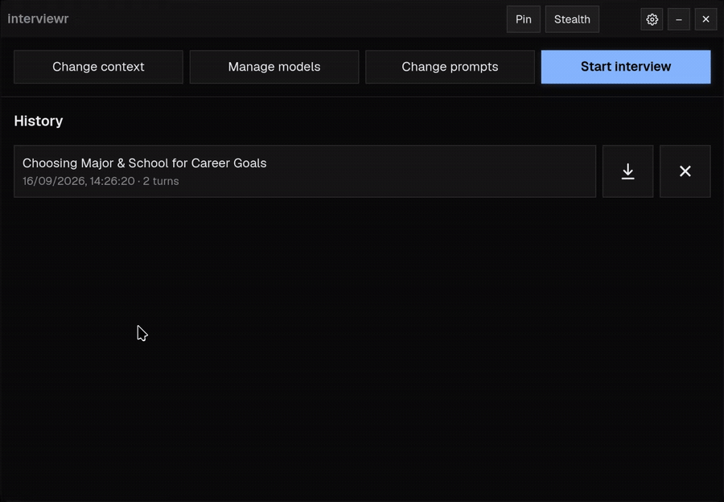
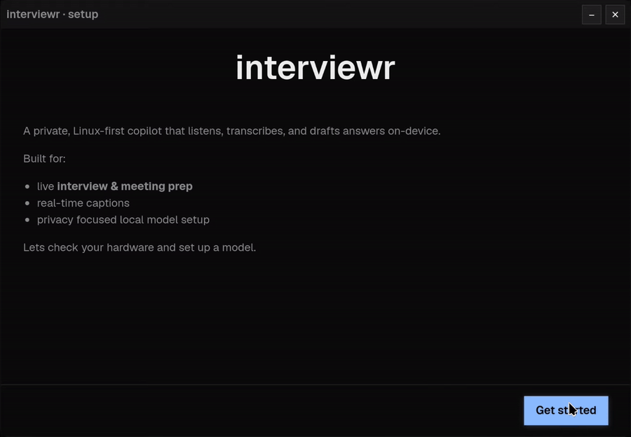

# interviewr-ai

**The interview/meeting copilot that runs on Linux and keeps your data on your machine.**

interviewr-ai listens to your interviews and meetings, transcribes them in real time, and
surfaces AI-generated answers in a native overlay. It is **Linux-first**,
**privacy-first**, and **subscription-free**.



## Features

- **Setup wizard** - reads your hardware on first run and picks an LLM and a speech model
  that fit your VRAM, then downloads them for you.
- **Local or bring your own key** - Ollama by default, so nothing leaves the machine. Switch to
  Anthropic, OpenAI, Gemini, Groq or cloud speech-to-text whenever you want.
- **Models managed in the app** - find, download, switch and delete models from the
  dashboard, with free-space checks. No terminal, no `ollama pull`.
- **Choose what gets captured** - all system audio, or one application isolated through a
  private null sink so notifications and music stay out of the transcript.
- **Live transcription** - whisper.cpp with the Vulkan backend, so the GPU is used on AMD,
  NVIDIA and Intel alike, with automatic CPU fallback.
- **Answers from your own material** - it spots the question and answers from your CV, the job
  description and the conversation so far, streamed into the overlay while the question is still
  being asked. The system prompt and answer style are editable.
- **Overlay that behaves** - global hotkeys, collapse to a strip, Pin on KDE and X11, hide
  from screencast on KDE Plasma 6.6+.
- **History** - every conversation saved, with Markdown and JSON export.

## Compared to Pluely

[Pluely](https://github.com/iamsrikanthnani/pluely) is the other open-source copilot that ships a
Linux build. Checked against Pluely 1.1.0 in October 2026; the rows about Pluely come from its own
documentation.

| | interviewr-ai | Pluely 1.1.0 |
|---|---|---|
| **Setup** | Wizard detects your GPU, picks models that fit, downloads them | Manual; the Linux docs point you at `pactl list short sources` |
| **Transcription** | whisper.cpp on your GPU, so audio never leaves the machine | Through a speech-to-text provider |
| **Audio source** | Picker, including isolating one application | The default output's monitor |
| **Hide from screen share** | KDE Plasma 6.6+ | ["not possible on Linux"](https://docs.pluely.com/docs/getting-started/permissions-linux) |
| **Keep on top** | KDE and X11 | ["GNOME ignores always-on-top"](https://docs.pluely.com/docs/getting-started/permissions-linux) |
| **Models** | Local by default, cloud optional | 277 hosted models on a plan, or bring your own keys |
| **macOS and Windows** | No | Yes |
| **Maturity** | 0.1.0, weeks old | 1.1.0, since August 2025 |

## Status

Working end to end on Linux/KDE, but still rough, so you will find bugs. Please
[open an issue](https://github.com/PSYEONE/interviewr-ai/issues/new) when you do.

The default system prompts are a starting point, which is why they are editable in Settings. If
you find wording that works better, say so in an issue.

**Planned:** Windows and macOS, and a coding helper for questions on screen.

## Install

Download the `.deb` from the [latest release](https://github.com/PSYEONE/interviewr-ai/releases/latest),
then:

```bash
sudo apt install ./interviewr-ai_0.1.0_amd64.deb
```

Built for Ubuntu 24.04 and newer. Other Ubuntu and Debian based distros should work but are untested.
The package includes its own Python and the GPU (Vulkan) transcription build, so nothing is compiled
on your machine.

To build the package yourself, run `./scripts/build-deb.sh` (needs docker). It builds on Ubuntu 24.04
so the result also installs on newer releases.

## Running from source

You need Python 3.12 or newer, Node, a Rust toolchain (1.77 or newer) and Tauri's Linux build
dependencies, listed on [their prerequisites page](https://v2.tauri.app/start/prerequisites/).

```bash
./scripts/install.sh       # engine + GPU transcription; re-run safely
cd overlay && npm install && npm run tauri dev
```

The installer creates `backend/.venv` and builds `pywhispercpp` against Vulkan so transcription
runs on the GPU. A plain `pip install` cannot do that, since pip serves a CPU-only wheel. The
script prompts once for the build packages it needs and refuses to report success if the GPU
build quietly fell back to the CPU. Pass `--cpu` to skip the GPU path deliberately, and see
[the Vulkan build notes](./docs/linux-vulkan-build.md) for what it automates and why.

To run the engine on its own:

```bash
cd backend
.venv/bin/python run_pipeline.py        # or: .venv/bin/uvicorn app.main:app --reload
# -> http://127.0.0.1:8765/health
```

## First run

Ollama isn't bundled. The setup wizard checks for it and shows the install command if it is
missing, recommends an LLM that fits your GPU's VRAM and downloads it, and fetches a whisper
model. That is why there is no `ollama pull` step above: naming a model up front would ignore
what the wizard knows about your hardware.



## Where your data lives

Run from source and the config and databases sit beside it (`.env` at the repo root,
`backend/data/`). An installed copy, which has no writable source tree, uses
`~/.config/interviewr/` and `~/.local/share/interviewr/` instead, and keeps both if you
uninstall. `INTERVIEWR_CONFIG_DIR` and `INTERVIEWR_STATE_DIR` override either.

## Choosing what gets captured

By default the engine records the **default sink's monitor**, which is all system audio: the
call, but also notification sounds, music, and every other tab.

**Settings > Audio > Capture from** narrows that to one application. The engine creates a
private null sink, routes that app's audio into it, loops it back to your speakers so you still
hear the call, and records only that sink. In testing, a second application playing at the same
time was attenuated by a factor of ~1.4e6, so it is effectively absent from the transcript.

## Architecture

A **Python/FastAPI engine** does capture, STT, RAG and LLM orchestration, and broadcasts
transcript + answer events over an **authenticated WebSocket** to any number of thin
clients. The **Tauri overlay** is the primary client; a phone/browser viewer can subscribe
to the same stream.

## Support this project

This is free and open source. If it helped you, consider supporting development:

- **GitHub Sponsors:** https://github.com/sponsors/PSYEONE
- **Crypto:** https://nowpayments.io/donation/psyeone (any of ~350 coins)

Found a problem or have an idea? [Open an issue](https://github.com/PSYEONE/interviewr-ai/issues/new).

Every bit keeps this Linux-first, privacy-first, and subscription-free.

## Contributing

See [CONTRIBUTING.md](./CONTRIBUTING.md). Code contributions need a
[Contributor License Agreement](./CLA.md); issues do not.

## License

[AGPL-3.0](./LICENSE).
